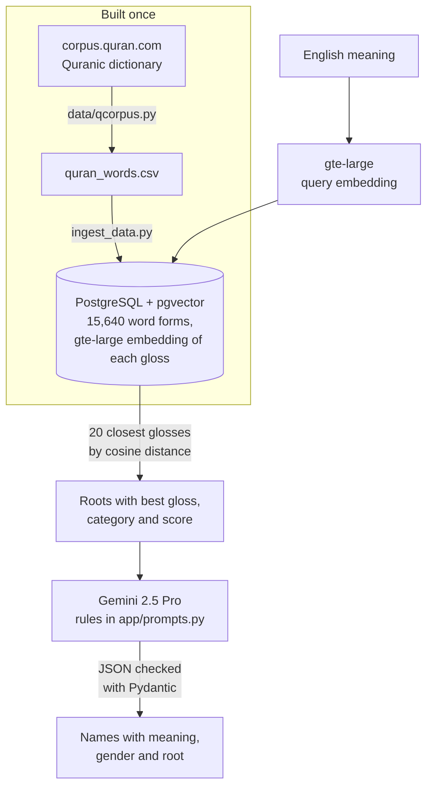

# Quranic Names

Describe a meaning in English and get children's names derived from Quranic Arabic roots. A semantic search over the Quranic Arabic Corpus finds the roots, and Gemini derives names from them under strict naming rules.


<!--  -->

## What it does

You type a meaning such as "light and guidance" or "patience". The app finds the Quranic words whose English glosses are closest in meaning, groups them by Arabic root, and asks Gemini 2.5 Pro for names derived from those roots. Each suggestion comes back with its meaning, gender and source root.

The web UI has three tabs:

- **Generate Quranic Names**: the chat flow above.
- **Find Root Words**: semantic search only, no LLM. For each matching root it lists the word forms with Arabic text, transliteration, English gloss, verse reference and similarity score.
- **Batch Generate**: walks through every name-bearing entry in the database (1,613, after particles, prepositions and similar grammatical categories are filtered out) and generates names five roots per Gemini call, with pause, resume and copy as JSON.

## How it works



**Building the index.** `data/qcorpus.py` reads the Quranic dictionary on corpus.quran.com. For each root it records every distinct word form with its Arabic text, transliteration, English gloss, part of speech, verse reference and verse text. `ingest_data.py` loads that CSV into normalised tables (letters, categories, roots, words) and stores a `thenlper/gte-large` embedding (1024 dimensions) of each English gloss. The result is 15,640 word forms under 1,664 dictionary entries.

**Search.** The embedding model is loaded once at startup through FastAPI's lifespan hook. A query is embedded with the same model, and pgvector ranks the stored glosses by cosine distance through SQLAlchemy. Matches are grouped by root, with a similarity score for each word and a best score for each root. A search takes about 0.4 s on a CPU-only machine.

**Generation.** `POST /api/chat` takes the 20 closest word forms, groups them into roots and sends each root with its category, best gloss and match score to Gemini 2.5 Pro at temperature 0.2. The system prompt in `app/prompts.py` sets the rules:

- only valid morphological derivations of the given roots;
- no names that belong to Allah alone (Rahim is fine, Ar-Rahman is not), and no names of controversial or negative figures;
- an accurate meaning tied to the root, and a gender: Male, Female or Unisex;
- positive meanings suitable for a child;
- roots with a good meaning that yield no valid name are listed separately;
- JSON only, in a fixed shape.

**Validation.** The reply is parsed as JSON and every suggestion is validated with Pydantic before it reaches the client. A failed API call gets up to three attempts with exponential backoff.

## Design notes

- **The embedding model was compared, not assumed.** `data/modeltest.py` scores five sentence-transformer models and a spaCy baseline on how closely abstract queries match their meanings and how well they separate from wrong ones. The app uses gte-large.
- **Vectors are stored per model.** Each embedding row points to an `embedding_models` entry, so another 1024-dimension model can be added and compared without touching the word data.
- **Ingestion can be re-run.** The scripts skip words and embeddings that are already stored, so an interrupted run picks up where it stopped.
- **One core, two interfaces.** `app/tools.py` holds the root search and name generation logic. The chat and batch endpoints and the MCP tools all call it.
- **LLM output is checked, not trusted.** Low temperature, a strict JSON contract and schema validation on every response.
- **Schema changes go through Alembic** (`migrations/`).

## Tech stack

Python 3.10, FastAPI and Uvicorn, PostgreSQL 14 with pgvector, SQLAlchemy 2 and Alembic, sentence-transformers with `thenlper/gte-large`, Google Gemini 2.5 Pro through `google-generativeai`, FastMCP, Pydantic 2, and a plain HTML, CSS and JavaScript frontend with no build step.

## Running it locally

You need Python 3.10, PostgreSQL 14 or later with the [pgvector](https://github.com/pgvector/pgvector) extension, and a Gemini API key for name generation. Search works without the key.

**1. Create the database and enable pgvector.** The migrations do not create the extension, so do it first:

```sql
CREATE DATABASE quranic_names;
\c quranic_names
CREATE EXTENSION IF NOT EXISTS vector;
```

**2. Install the dependencies.**

```bash
python3 -m venv .venv
source .venv/bin/activate
pip install -r requirements.txt
```

**3. Add a `.env` file** in the repository root:

```
DB_NAME=quranic_names
DB_USER=
DB_PASSWORD=
DB_HOST=localhost
DB_PORT=5432
GEMINI_API_KEY=
```

**4. Create the tables.**

```bash
alembic upgrade head
```

**5. Build the data.** The scraper requests about 1,700 pages from corpus.quran.com with a short pause between them, and embedding 15,640 glosses takes a while on a CPU.

```bash
cd data && python qcorpus.py && cd ..    # writes data/quran_words.csv
python ingest_data.py                    # loads the CSV, then embeds every gloss
```

If embedding everything in one go runs out of memory, `generate_embeddings.py` (batched, cached in `data/embeddings.pkl`) and then `save_embeddings_to_db.py` do the same job once `ingest_data.py` has loaded the words.

**6. Start the server** from the repository root:

```bash
uvicorn app.main:app --port 8000
```

Open http://127.0.0.1:8000. The frontend calls the API on the same host and port, so any port works. The first start downloads gte-large (about 640 MB) from Hugging Face. Interactive API docs are at http://127.0.0.1:8000/docs.

## API

| Method | Path | What it does |
| --- | --- | --- |
| `GET` | `/api/search?q=&limit=10&min_similarity=0` | Semantic search. `limit` is 1 to 50 word forms, `min_similarity` is a percentage. Results are grouped by root. |
| `POST` | `/api/chat` | Body `{"query": "..."}`. Returns name suggestions for the closest roots. |
| `GET` | `/api/root-words?skip=0&limit=10` | Pages through the name-bearing dictionary entries. |
| `POST` | `/api/generate-names` | Body `{"root_words": [...]}` with entries from `/api/root-words`. Returns names, plus the roots that yielded none. |
| `GET` | `/api/` | Health check. |

```bash
curl "http://127.0.0.1:8000/api/search?q=patience&limit=2"
```

```json
[
  {
    "sequence": "ص ب ر",
    "category": "Verb (form I)",
    "letter": "ص",
    "occurrences": [
      {
        "arabic_word": "صَبْرًا",
        "transliteration": "ṣabran",
        "english_text": "patience",
        "verse_reference": "(2:250:9)",
        "similarity_score": 100.0
      },
      {
        "arabic_word": "اصْبِرْ",
        "transliteration": "iṣ'bir",
        "english_text": "Be patient",
        "verse_reference": "(38:17:1)",
        "similarity_score": 95.27
      }
    ],
    "best_match_score": 100.0
  }
]
```

(Trimmed: each occurrence also carries the verse text and a corpus morphology link.)

`/api/chat` and `/api/generate-names` return the shape below:

```json
{
  "session_token": "...",
  "suggestions": [{ "name": "...", "meaning": "...", "gender": "Male | Female | Unisex", "root": "..." }],
  "unsuccessful_roots": [{ "sequence": "...", "transliteration": "...", "category": "...", "english_text": "..." }]
}
```

## MCP tools

`app/tools.py` exposes the same logic as two MCP tools built with FastMCP:

- `find_quranic_roots_by_meaning(query_text)`: semantic search, returning roots with their best gloss and score.
- `generate_names_from_roots(user_query, roots)`: name generation for a list of roots.

The running app serves both tools over streamable HTTP at http://127.0.0.1:8000/mcp/ (with the trailing slash), sharing the web app's embedding model, so any MCP client that supports streamable HTTP can connect there. Name generation needs the Gemini key; search does not.

## Project layout

```
app/
  main.py        FastAPI app: loads the model, mounts the API, MCP server and frontend
  api.py         REST endpoints
  tools.py       search and generation logic, and the MCP tools
  query.py       pgvector queries through SQLAlchemy
  llm.py         Gemini client with retries
  prompts.py     system prompt and prompt builder
  models.py      SQLAlchemy models (schema.py holds the Pydantic models)
migrations/      Alembic migrations
static/          HTML, CSS and JavaScript frontend
data/qcorpus.py  corpus scraper
data/modeltest.py  embedding model comparison
ingest_data.py   loads the CSV into PostgreSQL and embeds the glosses
```

## Status and roadmap

Phases 1 to 3 of [implementation-plan.md](implementation-plan.md) are done: the schema and migrations, search, Gemini name generation behind the REST API and MCP tools, and the web UI with chat, search and batch tabs.

Planned:

- **Phase 4, personalisation.** Like and dislike buttons on name cards with an optional reason that the LLM sorts into categories, preference vectors that steer the search and re-rank suggestions, and a programmatic check with camel-tools that every suggested name really derives from its root.
- **Phase 5, caching and monitoring.** A query cache in front of Gemini, a way to report bad suggestions with an admin review page, and prompt versioning for A/B tests.

The tables for sessions, preferences, stored suggestions and the query cache already exist (the second migration), but nothing writes to them yet.

Known limitations:

- Search matches English glosses, so a query can pull in another sense of the same English word: "light" retrieves ن و ر (light) and also خ ف ف (light in weight).
- The naming rules are enforced by the prompt alone until the Phase 4 check lands.
- There is no vector index yet. An exact scan over 15,640 vectors is fast enough at this size.

Names come from an LLM and can be wrong. Check a name with a scholar or a reliable reference before choosing it.

## Data source and credit

Word data comes from the [Quranic Arabic Corpus](https://corpus.quran.com), Copyright © Kais Dukes, 2009-2017, maintained by the quran.com team and published under the GNU General Public License with terms of use. The corpus terms ask that any website or application using it clearly indicates the source and links to http://corpus.quran.com, so keep this credit and link in any copy or deployment.

The web UI shows the same credit, with the link, at the foot of every page. This repository does not include the corpus data. `data/qcorpus.py` fetches it, and `data/quran_words.csv` and `data/embeddings.pkl` are git-ignored.

## License

The code is released under the [MIT License](LICENSE). The corpus data is not part of this repository and is not covered by that licence: it remains under the Quranic Arabic Corpus's GNU General Public License and terms of use.
