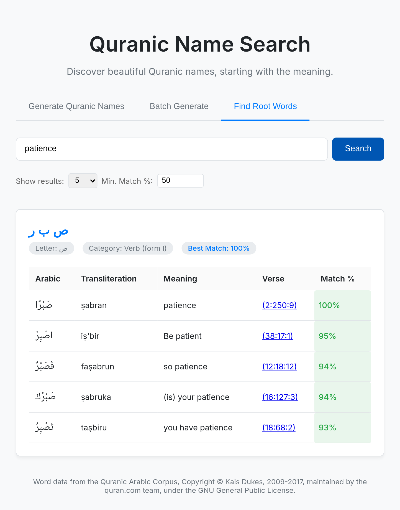
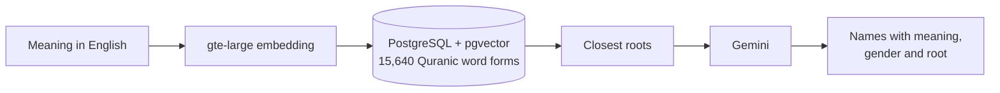

# Quranic Names

 

Find children's names rooted in the Quran. Describe a meaning in English, and the app finds matching Quranic root words by semantic search, then uses an LLM to derive Arabic names from them.



## Features

- **Names from a meaning.** Ask for "light and guidance" and get names with their meaning, gender and root.
- **Semantic root search.** Find Quranic words by meaning, with Arabic text, transliteration, verse reference and match score. No LLM needed.
- **Batch generation** across all 1,613 name-bearing roots.
- **MCP server**, so AI assistants can call the same search and generation tools.

## How it works



Each English gloss from the Quranic Arabic Corpus is embedded once with `thenlper/gte-large` and stored in pgvector. A query is embedded the same way, the closest roots are found by cosine distance, and Gemini derives names from them under strict rules: valid derivations only, no names that belong to Allah alone, and meanings suitable for a child. Every response is validated before it reaches the page.

**Stack:** FastAPI, PostgreSQL + pgvector, SQLAlchemy + Alembic, sentence-transformers, Gemini, FastMCP, plain HTML/CSS/JS.

## Getting started

You need Python 3.10+, PostgreSQL 14+ with [pgvector](https://github.com/pgvector/pgvector), and a [Gemini API key](https://aistudio.google.com/apikey) for name generation (search works without it).

```bash
git clone https://github.com/abdulmuizzf/quranic-names.git
cd quranic-names
python3 -m venv .venv && source .venv/bin/activate
pip install -r requirements.txt
```

Create a database, run `CREATE EXTENSION vector;` in it, and add a `.env` file:

```
DB_NAME=quranic_names
DB_USER=
DB_PASSWORD=
DB_HOST=localhost
DB_PORT=5432
GEMINI_API_KEY=
```

Build the data and start the server:

```bash
alembic upgrade head
cd data && python qcorpus.py && cd ..   # fetches the corpus (about 1,700 pages)
python ingest_data.py                   # loads and embeds it
uvicorn app.main:app --port 8000
```

Open http://127.0.0.1:8000. API docs are at `/docs` and the MCP server at `/mcp/`.

## Roadmap

- Like and dislike names to personalise suggestions
- Check each name's derivation in code, not only in the prompt
- Cache Gemini responses

## Credits

Word data comes from the [Quranic Arabic Corpus](http://corpus.quran.com), Copyright © Kais Dukes, 2009-2017, maintained by the quran.com team, under the GNU General Public License. Keep this credit and link in any copy or deployment. The data is not included in this repository.

Names are generated by an LLM and can be wrong. Check a name with a scholar or a reliable reference before choosing it.

## License

[MIT](LICENSE). The corpus data keeps its own licence.
